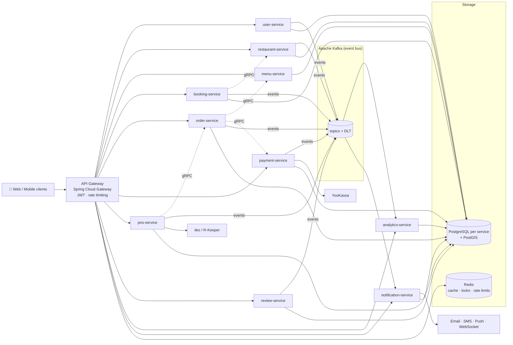

<div align="center">

# 🍽️ Mark Tuttime Backend

**Production-grade restaurant booking & pre-order platform built with Spring Boot microservices, Kafka, gRPC and Kubernetes (K3s).**

Book a table, pre-order from the menu, pay online, and have the order land in the restaurant's POS — with dynamic off-peak discounts to fill empty tables.

[](https://github.com/Markcus0526/mark-tuttime-backend/actions/workflows/ci-cd-pipeline.yaml)
[](LICENSE.md)


[](CONTRIBUTING.md)
[](https://github.com/Markcus0526/mark-tuttime-backend/stargazers)

[Features](#-features) •
[Architecture](#-architecture) •
[Quick start](#-quick-start-docker) •
[Kubernetes](#-deploy-to-kubernetes-k3s) •
[Configuration](#-configuration) •
[Contributing](#-contributing)

</div>

---

## 💡 Why this project?

Most microservice examples stop at "hello world". Mark Tuttime is a **complete, real-world backend** you can read,
run and reuse: 10 domain services and an API gateway, each with its own database, talking over **REST, gRPC and
Kafka**, and shipped with **production Kubernetes manifests** (HA Kafka, Redis Sentinel, TLS, NetworkPolicies, mTLS).

Use it as:

- a **reference architecture** for Spring Boot / Spring Cloud microservices,
- a **starter** for booking, ordering or marketplace products,
- a **learning resource** for Kafka event-driven design, gRPC, JWT security and K3s operations.

If it helps you, please **⭐ star the repo** — it really helps others find it.

## ✨ Features

**Business**
- 🪑 Table reservations with slot management and Redis-based booking locks (no double booking)
- 🧾 Menu pre-orders with categories, items, modifiers and discounts
- 📉 Yield management: dynamic discounts during off-peak hours
- 💳 Online payments and refunds (YooKassa integration)
- 🖥️ POS integration with **iiko** and **R-Keeper**
- ⭐ Reviews, ratings and moderation
- 📊 Analytics: event aggregation, reports and forecasting
- 🔔 Notifications: email, SMS, push and WebSocket
- 📍 Geo search for restaurants and branches (PostGIS)

**Engineering**
- 🧩 Database-per-service with **Flyway** migrations
- 📨 Event-driven communication with **Apache Kafka** (dead-letter topics, retry)
- ⚡ Fast internal calls over **gRPC**
- 🔐 **JWT** authentication, Google / Apple sign-in, rate limiting and brute-force protection at the gateway
- 🛡️ **Resilience4j** circuit breakers and retries
- 🔭 Observability: **Micrometer + Prometheus + Grafana**, **Zipkin** tracing, **Graylog** centralized logs
- ☸️ **K3s / Kubernetes** manifests (Kustomize) and **Helm** charts
- 🏗️ High availability: 3-broker KRaft Kafka with SASL/SCRAM, Redis Sentinel, CloudNativePG, Linkerd mTLS
- 🤖 CI/CD with GitHub Actions (build, test, Docker images)

## 🏛️ Architecture



> Simplified view. In the code, services call each other synchronously over **gRPC** (contracts in
> `common-libs/common-event`) and publish domain events to **Kafka**; analytics and notifications consume
> most events, and other services react to the ones they need. Every service uses Redis for caching.

### Services

| Service | REST | gRPC | Responsibility |
|---------|-----:|-----:|----------------|
| [api-gateway](api-gateway) | 8080 | – | Routing, JWT auth, rate limiting, brute-force protection, aggregated Swagger |
| [user-service](services/user-service) | 28001 | 29001 | Users, authentication, Google / Apple sign-in |
| [restaurant-service](services/restaurant-service) | 28002 | 29002 | Restaurants, branches, tables, schedules, geo search (PostGIS) |
| [menu-service](services/menu-service) | 28003 | 29003 | Menu categories, items, modifiers, discounts |
| [booking-service](services/booking-service) | 28004 | 29004 | Table reservations, slot management, Redis locks |
| [order-service](services/order-service) | 28005 | 29005 | Pre-orders, order status, kitchen sync |
| [payment-service](services/payment-service) | 28006 | 29006 | Payments and refunds (YooKassa) |
| [pos-service](services/pos-service) | 28007 | 29007 | iiko / R-Keeper POS integration |
| [review-service](services/review-service) | 28008 | 29008 | Reviews, ratings, moderation |
| [analytics-service](services/analytics-service) | 28009 | 29009 | Event aggregation, reports, forecasting |
| [notification-service](services/notification-service) | 28010 | 29010 | Email, SMS, push, WebSocket |

**Infrastructure:** PostgreSQL (one database per service), Redis, Kafka (KRaft), Zipkin, Graylog (+ OpenSearch, MongoDB), Kafka UI.

## 🧰 Tech stack

| Area | Technologies |
|------|--------------|
| Language & framework | Java 21, Spring Boot 3.3, Spring Cloud 2023.0 |
| API | Spring Cloud Gateway (WebFlux), REST, gRPC (`grpc-spring-boot-starter`), OpenAPI / Swagger |
| Security | Spring Security, JWT, Redis rate limiter, Linkerd mTLS (optional) |
| Data | Spring Data JPA, Hibernate, PostgreSQL, PostGIS, Flyway, Redis (Lettuce) |
| Messaging | Apache Kafka (KRaft, SASL/SCRAM, dead-letter topics) |
| Resilience | Resilience4j (circuit breaker, retry) |
| Observability | Micrometer, Prometheus, Grafana, Zipkin, Graylog |
| Build & tooling | Maven multi-module, MapStruct, Lombok, JUnit 5, Mockito |
| Delivery | Docker, Docker Compose, K3s, Kustomize, Helm, GitHub Actions |

## 📁 Project structure

```text
tuttime-backend/
├── api-gateway/            # Spring Cloud Gateway (entry point)
├── common-libs/
│   ├── common/             # shared DTOs and utilities
│   ├── common-event/       # gRPC stubs and Kafka event schemas
│   └── common-auth/        # JWT and security utilities
├── services/               # 10 domain microservices (each with its own docker-compose.yml)
├── db-migrations/          # Flyway SQL migrations per service
├── infrastructure/         # Docker Compose: Redis, Kafka, Zipkin, Graylog, Kafka UI
├── k3s/                    # Kubernetes manifests (Kustomize)
├── tuttime-charts/         # Helm charts
├── docs/                   # HA, mTLS, DB HA and disaster-recovery runbooks
├── scripts/linux/          # build, start/stop, deploy and maintenance scripts
└── pom.xml                 # parent Maven POM
```

## 🚀 Quick start (Docker)

### Prerequisites

- Docker and Docker Compose v2
- Java 21 and Maven 3.9+ (only to build or run services outside Docker)
- ~16 GB RAM for the full stack

### 1. Clone and configure

```bash
git clone https://github.com/Markcus0526/mark-tuttime-backend.git
cd mark-tuttime-backend
```

Each module reads its settings from a `.env.docker` file (Docker) or a `.env` file (running from the IDE).
These files are **not committed**. Create them from the templates:

```bash
for dir in infrastructure api-gateway services/*; do
  cp "$dir/.env.docker.example" "$dir/.env.docker"   # used by docker compose
  cp "$dir/.env.example"        "$dir/.env"          # used when running from the IDE
done
```

The `.env.docker.example` templates contain working **development-only** values (`dev-only-…`), so the
stack starts as-is. Third-party integrations (YooKassa, Twilio, e-mail, S3, Google sign-in) need your own
credentials to work.

> 🔒 Never commit real credentials. `.env`, `.env.docker` and the K3s `secret.yaml` files are git-ignored.
> Use long random secrets in production, e.g. `openssl rand -base64 48`.

### 2. Start everything

```bash
./scripts/linux/docker-start-all.sh
```

This starts the infrastructure first, then the API gateway and all services, and waits for each container to become healthy.

### 3. Explore the API

| What | URL |
|------|-----|
| API gateway | http://localhost:8080 |
| Swagger UI (aggregated) | http://localhost:8080/swagger-ui.html |
| Swagger UI (single service) | http://localhost:28001/swagger-ui.html (user-service, etc.) |
| Kafka UI | http://localhost:9001 |
| Zipkin | http://localhost:9411 |

Stop everything with `./scripts/linux/docker-stop-all.sh`.

### Run a single service from your IDE

Start the infrastructure with Docker, then run the service with the variables from its `.env`
(or load the file with your IDE's EnvFile plugin). Set `JWT_SECRET`, `CLUSTER_INTERNAL_SECRET` and the Kafka
password in `.env` to the same values as in `.env.docker`:

```bash
mvn clean install -DskipTests                  # build shared libs once
cd services/user-service
set -a; source .env; set +a                    # export the service's variables
mvn spring-boot:run
```

## ☸️ Deploy to Kubernetes (K3s)

The full, step-by-step guide is in **[K3S_GUIDE.md](K3S_GUIDE.md)**. The short version:

```bash
# 1. Install K3s
curl -sfL https://get.k3s.io | INSTALL_K3S_EXEC="--write-kubeconfig-mode 644" sh -

# 2. Build JARs and images, import them into K3s containerd
mvn clean install -DskipTests
./scripts/linux/docker-image-build-all.sh
./scripts/linux/k3s-import-image-all.sh

# 3. Create secrets from the templates (never commit them)
for f in k3s/*/secret.yaml.example k3s/*/db-secret.yaml.example k3s/infra/global-infra-secret.yaml.example; do
  cp "$f" "${f%.example}"
done
# ...edit the copied files with your own values...

# 4. Deploy everything with Kustomize
kubectl create namespace tuttime
kubectl apply -k k3s/
```

Or run the all-in-one script: `./scripts/linux/k3s-deploy-all.sh`.

Install these **before** deploying (they are not part of the Kustomize bundle):

- **cert-manager** — edge TLS (`k3s/infra/cluster-issuer.yaml`)
- **CloudNativePG** — only if you use database HA ([docs/DB_HA.md](docs/DB_HA.md))
- **Linkerd** — only if you enable service mTLS ([docs/MTLS.md](docs/MTLS.md))

The gateway is exposed as a NodePort on `http://<node-ip>:30080`. Helm charts are available in [`tuttime-charts/`](tuttime-charts).

### Production / HA posture

- **Kafka** — 3 brokers (KRaft), SASL/SCRAM-SHA-256, RF=3 / minISR=2, auto-create off, per-topic `.DLT` dead-letter topics
- **Redis** — 1 master + 2 replicas + 3 Sentinels with automatic failover
- **Edge** — Traefik ingress with cert-manager TLS and security-header middleware
- **Security** — NetworkPolicies, non-root pods with seccomp, fail-closed brute-force protection, optional Linkerd mTLS
- **Stateless services** run with ≥ 2 replicas

### Monitoring

Install `kube-prometheus-stack` and import Grafana dashboard **12900** (Spring Boot statistics).
See [GRAFANA_README.md](GRAFANA_README.md) or run `./scripts/linux/grafana-install.sh`.

## ⚙️ Configuration

Each service uses a ConfigMap for non-sensitive values and a Secret for credentials (or `.env` files locally). Key variables:

| Variable | Purpose |
|----------|---------|
| `DATABASE_URL` | PostgreSQL JDBC URL |
| `SPRING_PROFILES_ACTIVE` | `k3s` in the cluster, `graylog-enabled` for central logging |
| `JWT_SECRET` | JWT signing key (use a long random value) |
| `CLUSTER_INTERNAL_SECRET` | Shared secret for internal service-to-service calls |
| `SPRING_DATA_REDIS_*` | Redis host / Sentinel nodes and password |
| `SPRING_KAFKA_BOOTSTRAP_SERVERS` | Kafka bootstrap servers |
| `SPRING_KAFKA_PROPERTIES_SASL_JAAS_CONFIG` | Per-service Kafka SCRAM credentials |
| `YOOKASSA_SHOP_ID` / `YOOKASSA_SECRET_KEY` | Payment provider credentials |
| `GOOGLE_CLIENT_ID` / `APPLE_CLIENT_ID` | Social sign-in |
| `RATE_LIMIT_REPLENISH_RATE` / `RATE_LIMIT_BURST_CAPACITY` | Gateway rate limiter |
| `BRUTEFORCE_FAIL_OPEN` | Behaviour on Redis outage (`false` = fail-closed) |
| `SPRINGDOC_ENABLED` | Enable Swagger / OpenAPI docs |
| `APP_TEST_ENDPOINTS_ENABLED` | Enable `/payments/test/**` (development only) |

The full list for each service is in its `.env.example`.

## 🧪 Testing

```bash
mvn clean test                                   # all modules
mvn clean test -pl services/booking-service -am  # one service and its dependencies
```

Tests use JUnit 5 and Mockito and run in CI on every push.

## 🛠️ Scripts

| Script | What it does |
|--------|--------------|
| `docker-start-all.sh` / `docker-stop-all.sh` | Start / stop the full stack with Docker Compose |
| `docker-image-build-all.sh` / `docker-image-remove-all.sh` | Build / remove all service images |
| `k3s-import-image-all.sh` | Import images into K3s containerd |
| `k3s-deploy-all.sh` | Deploy everything to K3s from scratch |
| `k3s-reinstall.sh` / `k3s-cleanup-all.sh` | Reinstall K3s / remove all resources |
| `databases-backup.sh` / `database-restore.sh` | Back up / restore all PostgreSQL databases |
| `redis-cache-clear-all.sh` | Flush Redis caches |
| `swagger-ui-run.sh` / `swagger-ui-stop.sh` | Start / stop a standalone Swagger UI |
| `grafana-install.sh` | Install Prometheus + Grafana monitoring |

All scripts live in [`scripts/linux/`](scripts/linux).

## 📚 Documentation

| Document | Covers |
|----------|--------|
| [K3S_GUIDE.md](K3S_GUIDE.md) | Full K3s installation and deployment guide |
| [GRAFANA_README.md](GRAFANA_README.md) | Monitoring with Prometheus and Grafana |
| [docs/HA_INFRA.md](docs/HA_INFRA.md) | 3-broker Kafka and Redis Sentinel: apply order, validation, rollback |
| [docs/MTLS.md](docs/MTLS.md) | Service-to-service mTLS with Linkerd |
| [docs/DB_HA.md](docs/DB_HA.md) | PostgreSQL HA with CloudNativePG |
| [docs/DISASTER_RECOVERY.md](docs/DISASTER_RECOVERY.md) | Backup, restore, full-cluster rebuild, RPO / RTO |

## 🤝 Contributing

Contributions are welcome — bug reports, features, docs and ideas.
Read [CONTRIBUTING.md](CONTRIBUTING.md) to get started and check the
[open issues](https://github.com/Markcus0526/mark-tuttime-backend/issues).
Please follow the [Code of Conduct](CODE_OF_CONDUCT.md), and report security issues privately as described in [SECURITY.md](SECURITY.md).

## 📄 License

Released under the [MIT License](LICENSE.md). You are free to use it in your own projects, commercial or not.

---

<div align="center">

**If Mark Tuttime saved you time, give it a ⭐ — it keeps the project going!**

</div>
